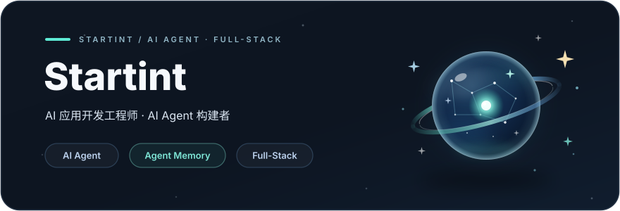
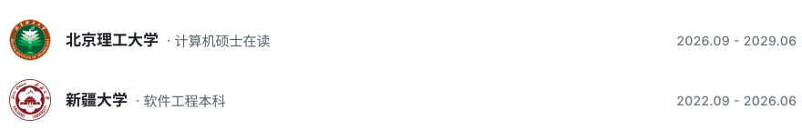

<h1 align="center">你好 👋，我是 <a href="https://github.com/jwwang2025">Startint</a></h1>

<h3 align="center">
  
</h3>

  
  &nbsp;
  
  &nbsp;
  

---

<h3 align="left">关于我：</h3>

- 🧠 Agent 的核心是记忆，而试错与迭代是记忆积累的关键
- 🔭 专注于 AI Agent 与应用开发
- 🌱 持续探索全栈开发与 AI 的新边界
- 💬 欢迎交流 AI、Agent、全栈开发相关话题

<h3 align="left">我的经历：</h3>

<a href="https://www.bit.edu.cn">
  <picture>
    <source media="(prefers-color-scheme: dark)" srcset="assets/experience-dark.svg" />
    <source media="(prefers-color-scheme: light)" srcset="assets/experience-light.svg" />
    
  </picture>
</a>

<h3 align="left">语言和工具：</h3>

<table>
  <tr>
    <td></td>
    <td></td>
    <td></td>
    <td></td>
    <td><a href="https://github.com/openai/codex"><picture><source media="(prefers-color-scheme: dark)" srcset="assets/icons/codex-dark.svg"/></picture></a></td>
    <td></td>
    <td></td>
    <td></td>
    <td><a href="https://www.trae.cn"><picture><source media="(prefers-color-scheme: dark)" srcset="assets/icons/trae-dark.svg"/></picture></a></td>
    <td></td>
    <td></td>
    <td></td>
    <td></td>
    <td></td>
  </tr>
</table>

<h3 align="left">Projects：</h3>

  <table width="100%">
    <tr>
      <td width="50%" align="center"></td>
      <td width="50%" align="center"></td>
    </tr>
  </table>

---

<h3 align="left">GitHub统计：</h3>

  <table width="100%">
    <tr>
      <td width="50%" align="center"></td>
      <td width="50%" align="center"></td>
    </tr>
  </table>

  <picture>
    <source media="(prefers-color-scheme: dark)" srcset="https://raw.githubusercontent.com/jwwang2025/jwwang2025/output/github-contribution-grid-snake-dark.svg" />
    <source media="(prefers-color-scheme: light)" srcset="https://raw.githubusercontent.com/jwwang2025/jwwang2025/output/github-contribution-grid-snake.svg" />
    
  </picture>

